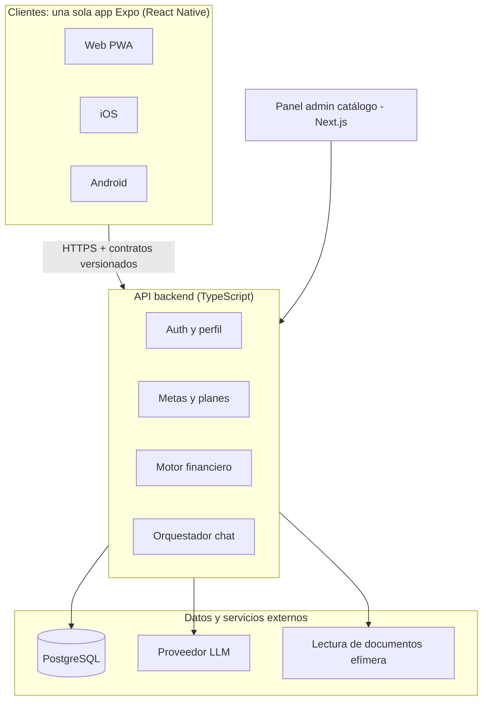

# Arquitectura

> Parte del Financial Genius Panamá — Product Master Spec v1 (14 oct 2026). Fuente de verdad: este repo.

## 9. Arquitectura Web + iOS + Android

**Un solo código cliente (Expo / React Native con soporte web) y un solo backend API-first.** Es la forma realista de tener las tres plataformas siendo una sola persona; lo nativo puro queda para cuando haya tracción.

El motor financiero es un paquete de TypeScript puro, sin dependencias de UI ni de base de datos, para poder probarlo y reutilizarlo en cualquier cliente.

### Stack propuesto

| Capa | Elección | Por qué |
| --- | --- | --- |
| Monorepo | pnpm + Turborepo | Comparte tipos, motor y contratos entre app, admin y API |
| App (Web, iOS, Android) | Expo + Expo Router + TypeScript | Un código para las 3 plataformas; web como PWA |
| UI | Tamagui o NativeWind + componentes propios | Mismo diseño en móvil y web |
| Panel admin | Next.js | Solo interno, para cargar y versionar el catálogo |
| API | Node.js + Fastify (o NestJS) + Zod | Contratos tipados y versionados (OpenAPI) |
| Base de datos | PostgreSQL (Supabase o Neon) + Prisma o Drizzle | Relacional, ideal para catálogo versionado y auditoría |
| Auth | Supabase Auth o Clerk (email, Google, Apple) | Login social en iOS exige Sign in with Apple |
| LLM | Claude API con tool calling, detrás de una interfaz propia | Se puede cambiar de proveedor sin tocar el motor |
| Extracción de documentos | LLM con visión, procesado en memoria, sin guardar el archivo | Cumple el principio de documentos efímeros |
| Notificaciones | Expo Notifications (móvil) + email | Check-ins y recordatorios de misiones |
| Analytics | PostHog | Embudos de activación y retención |
| Hosting | Railway, Render o Fly.io (API) + Vercel (admin) + EAS (builds móviles) | Barato al inicio, sin servidores que administrar |

El stack es una recomendación; si dominas otro (por ejemplo .NET para la API), el principio que importa es motor y contratos independientes del framework.

### Módulos del backend

- `auth-profile`: usuarios, consentimientos, snapshots financieros.
- `goals-plans`: metas, prioridades, planes mensuales, misiones, check-ins.
- `engine`: cálculos, índice de preparación, frenos, ranking (paquete puro).
- `catalog`: instituciones, productos, versiones, fuentes.
- `conversation`: orquestador del LLM; expone el motor y el catálogo como tools.
- `audit`: registro de recomendaciones y versiones usadas.
