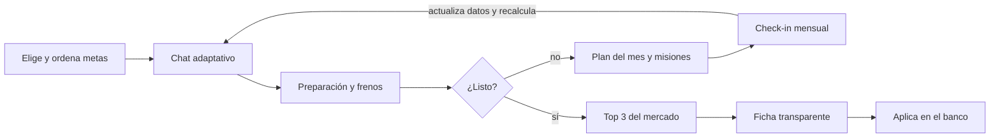
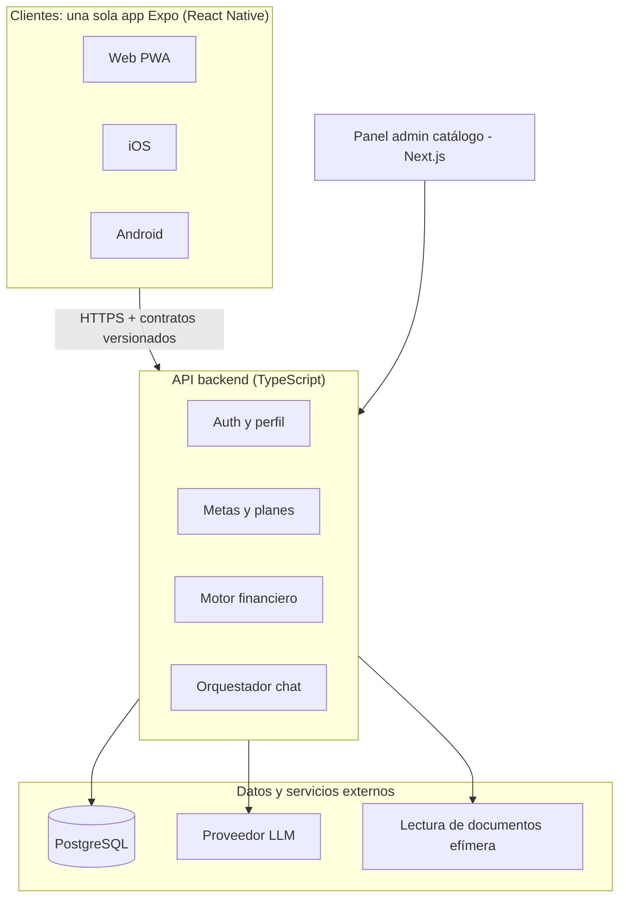
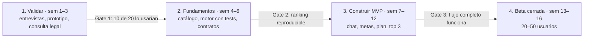

# Financial Genius Panamá — Product Master Spec v1

Oct 14, 2026 · @Eduardo

## 1. Resumen ejecutivo

**Financial Genius Panamá es un genio financiero conversacional que convierte tus metas en rutas, te acompaña con misiones semanales y, cuando estás listo, busca en todo el mercado panameño las 3 mejores opciones para ti.**

Este documento es la fuente de verdad del producto. Fusiona los 7 conceptos de UX explorados (Hitmonk, Duolingo, Airbnb, Genius Chat, Financial GPS, Opportunity Radar y Financial OS) en un solo producto con un solo backend.

**Propuesta de valor en una frase:** Tú me dices a dónde quieres llegar; yo te digo cómo llegar y qué producto pedir cuando estés listo.

**Decisiones clave de esta versión:**

- Un solo producto y un solo backend. Los 7 conceptos son experimentos de UX, no productos separados.
- MVP 1 = Chat + Metas/Ruta + Misiones + Top 3 del mercado. Radar entra en V2; Financial OS es la visión a 5 años.
- Un solo código cliente para Web, iOS y Android (Expo/React Native + web). Nada nativo puro en el MVP.
- El LLM conversa y explica; las tasas, requisitos y el ranking salen de datos y reglas deterministas, nunca del modelo.
- Antes de escribir mucho código: validar demanda con 10–20 personas y revisar el marco legal en Panamá.

**Riesgos principales:** mantener el catálogo bancario actualizado, el marco regulatorio de recomendar productos financieros y lograr confianza del usuario para compartir datos sensibles.

## 2. Qué tomamos de cada concepto

Cuatro conceptos forman el núcleo del MVP; Airbnb aporta la filosofía de diseño; Radar y Financial OS quedan para después.

| Concepto | Rol en el producto | Qué tomamos | Qué dejamos fuera | Fase |
| --- | --- | --- | --- | --- |
| 04 Genius Chat | Cerebro y personalidad | Chat como entrada principal, preguntas una a una, tarjetas interactivas dentro del chat, contexto persistente | Esconder todo detrás del chat: metas, plan y productos siempre visibles como pantallas | MVP 1 |
| 05 Financial GPS | Concepto central | Meta = destino; situación actual → obstáculos → hitos → "listo para comparar"; recalcular ruta cuando cambian datos | Rutas alternativas (rápida, barata, menor riesgo) | MVP 1 (alternativas en V2) |
| 02 Duolingo | Progresión y hábito | % de preparación por meta, plan del mes como "capítulo", acciones semanales como misiones, check-in mensual | Rachas, ligas, premiar pedir crédito o endeudarse | MVP 1 |
| 01 Hitmonk | Momento de decisión | Top 3 explicado, "por qué encaja contigo", comparador expandible, "¿por qué quedó #2?" | Comparador abierto tipo buscador como pantalla principal | MVP 1 |
| 03 Airbnb | Diseño y confianza | Fichas de producto limpias, "por qué te la mostramos", "qué confirmar con el banco", patrocinios separados y etiquetados | Home editorial tipo marketplace | MVP 1 (como guía de diseño) |
| 06 Opportunity Radar | Proactividad | Señales de oportunidad y riesgo con impacto y evidencia | Todo en MVP: requiere historial y datos frescos | V2 |
| 07 Financial OS | Visión | "Gemelo financiero", historial de decisiones, módulo de deudas y productos actuales | Todo como MVP | V3 / 5 años |

**El producto en una línea por concepto:** el chat entiende (Genius), la ruta orienta (GPS), las misiones mueven (Duolingo), el top 3 decide (Hitmonk), todo se ve confiable (Airbnb), luego el sistema avisa (Radar) y al final lo organiza todo (OS).

## 3. Usuarios, problema y principios

**El problema:** en Panamá, una persona que quiere una casa, un auto o una tarjeta no sabe si está lista, qué la frena ni qué banco le conviene. Compara a mano, banco por banco, y aplica a ciegas. Un rechazo cuesta tiempo y puede afectar su historial.

### Usuarios objetivo del MVP

| Segmento | Situación | Meta típica | Qué necesita del Genio |
| --- | --- | --- | --- |
| Asalariado joven (25–40) | Empleo formal, poco o ningún historial de crédito | Primera tarjeta, primer auto | Saber si califica y cuál pedir primero |
| Familia que quiere comprar casa | Ingreso estable, algunas deudas | Hipoteca | Ruta de 6–18 meses para estar listo |
| Endeudado que quiere ordenarse | Varias tarjetas o préstamos | Consolidar deuda, bajar utilización | Plan mes a mes y mejor producto de consolidación |
| Independiente / informal | Ingresos variables o sin planilla | Tarjeta asegurada, préstamo pequeño | Opciones reales para su perfil |

**Usuario piloto:** asalariado formal con 1–3 metas (tarjeta + auto o casa). Es el segmento con más productos disponibles y datos más fáciles de reunir.

### Principios no negociables

1. **Varias metas, con prioridad.** El usuario elige una o varias metas y las ordena.
2. **Recomienda, explica y acompaña; nunca promete aprobación.** No inventa políticas internas de los bancos.
3. **APC reportado y preparación propia, siempre separados.** El índice de preparación es nuestro y se dice así.
4. **Diagnóstico adaptativo.** Pregunta solo lo necesario para la meta elegida.
5. **Documentos efímeros en el MVP.** Se extraen datos, el usuario confirma y el original se borra.
6. **El dinero nunca altera el ranking.** Patrocinios separados y etiquetados.
7. **Cada recomendación muestra sus razones, sus supuestos, la fuente y la fecha del dato.**
8. **El LLM no es fuente de verdad** para tasas, costos ni requisitos.
9. **Gratis útil de verdad.** Premium añade acompañamiento continuo, no desbloquea lo básico.
10. **Nada de gamificar la deuda.** Se celebra preparar y ordenar, no pedir crédito.

## 4. Experiencia de producto

**El chat es la puerta de entrada; Metas, Plan y Productos son la memoria visible de lo que el Genio sabe y está siguiendo.** Nada importante vive solo dentro del chat.

### Flujo principal



El usuario entra por el chat, recibe su preparación por meta y, según esté listo o no, pasa al top 3 o a las misiones del mes. Cada check-in recalcula la ruta. En el MVP la solicitud se hace directamente con el banco, fuera de la app.

### Navegación (5 tabs, igual en Web, iOS y Android)

| Tab | Concepto de origen | Qué muestra |
| --- | --- | --- |
| Genio (inicio) | Genius Chat | Conversación persistente, tarjetas interactivas, sugerencias rápidas ("quiero una tarjeta con cashback") |
| Metas | GPS + Duolingo | Cada meta como destino: % de preparación, frenos, próximo hito, prioridad 1/2/3 |
| Plan | Duolingo | Plan del mes y misiones de la semana, con checkbox y progreso |
| Productos | Hitmonk + Airbnb | Top 3 por meta, fichas, comparador, guardados |
| Perfil | Financial OS (básico) | Datos financieros, de dónde sale cada dato, consentimientos, plan Free/Premium |

### Ejemplo de tarjeta de meta

> 🏠 **Comprar mi casa** — Preparación: 47%  
> Meta del mes: bajar utilización de tarjetas a menos de 30%  
> Esta semana: ✓ Pagar tarjeta A · ○ Actualizar deuda B · ○ Pedir carta de trabajo

### Ejemplo de momento Hitmonk

> Revisé 18 tarjetas disponibles en Panamá. Estas 3 encajan mejor contigo: #1 Banco X, #2 Banco Y, #3 Banco Z. ¿Te explico por qué las ordené así?

### Reglas de UX

- Una pregunta a la vez en el chat; botones de respuesta rápida siempre que se pueda.
- Primera recomendación útil en menos de 5 minutos.
- Toda cifra muestra fuente y fecha; todo ranking tiene "¿por qué?".
- Notificaciones abren una conversación concreta: "Actualicemos tu plan de noviembre".
- Celebraciones sobrias al completar misiones; nunca por solicitar crédito.

## 5. Alcance: MVP 1, V2, V3 y visión

**El MVP 1 resuelve una sola cosa bien: "dime si estoy listo para X, qué hacer este mes y qué producto pedir"**, con 3 tipos de meta y datos ingresados por el usuario.

### MVP 1 — entra

- Onboarding conversacional y selección de varias metas con prioridad.
- **Solo 3 tipos de meta:** tarjeta de crédito, préstamo de auto e hipoteca. (Préstamo personal y consolidación en V2.)
- Perfil financiero básico: ingreso, tipo de empleo, antigüedad, deudas y pagos mensuales, APC conocido (autodeclarado), dependientes.
- Carga opcional de un documento (ficha CSS, talonario o carta de trabajo), extracción con confirmación y borrado del original.
- Índice de preparación por meta (0–100) y hasta 4 frenos principales.
- Plan del mes y 3–5 misiones semanales; check-in mensual manual.
- Catálogo inicial de 8–12 bancos y unos 40–60 productos, cargado con ayuda de IA: se pega la URL o el PDF del banco, la IA propone la ficha y una persona la aprueba.
- Top 3 explicado por meta, ficha de producto y comparador simple.
- Chat contextual sobre cualquier meta, freno o producto.
- Cuenta, login y sincronización entre Web y móvil.
- Paywall preparado pero apagado al inicio (todo gratis durante la validación).

### MVP 1 — no entra

- Aplicar a productos desde la app, referidos pagados y publicidad.
- Conexión con bancos o con la APC.
- Radar, alertas automáticas y rutas alternativas.
- Guardar documentos (bóveda).
- Apps nativas separadas (Swift / Kotlin).

### Fases

| Fase | Objetivo | Incluye | Condición para pasar a la siguiente |
| --- | --- | --- | --- |
| MVP 1 | Validar que la gente quiere la ruta y confía en el top 3 | Lo de arriba | 50+ usuarios activos, 40% vuelve al check-in del mes 2 |
| V2 | Retención y primeros ingresos | Premium activo, Radar básico (sobre datos del usuario y cambios del catálogo), rutas alternativas, préstamo personal y consolidación, notificaciones push | 5% de conversión a Premium o un acuerdo de referidos firmado |
| V3 | Distribución y monetización con bancos | Referidos y solicitud asistida, patrocinios etiquetados, bóveda de documentos con consentimiento, historial de decisiones | Marco legal resuelto para intermediación |
| Visión (3–5 años) | Financial OS | Gemelo financiero, integraciones autorizadas, optimización continua de todos los productos del usuario | — |

Las condiciones de paso son hipótesis iniciales; se ajustan con los primeros datos reales.

## 6. Motor de preparación y recomendación

**Tres capas separadas: reglas deterministas calculan, el catálogo aporta los datos, el LLM solo conversa y explica.** El ranking debe ser reproducible: mismo perfil + misma versión del catálogo = mismo resultado.

### Capa 1 — Cálculos financieros (código puro, con tests)

- **Ratio deuda/ingreso (DTI):** pagos mensuales de deuda ÷ ingreso mensual neto.
- **Capacidad de pago:** ingreso − gastos fijos − deudas − colchón mínimo.
- **Cuota estimada** del producto (tasa, plazo, monto) con fórmula de amortización estándar.
- **Utilización de crédito:** saldo de tarjetas ÷ límites.
- **Abono/enganche disponible** frente al requerido (auto, casa).

### Capa 2 — Índice de preparación por meta (0–100)

Puntaje propio, explicable, por meta. No es el APC y se muestra separado. Cada meta tiene su receta de factores con pesos configurables (no en código):

| Factor | Tarjeta | Auto | Hipoteca |
| --- | --- | --- | --- |
| Ingreso vs. mínimo del mercado | Alto | Alto | Alto |
| DTI con la nueva cuota | Medio | Alto | Muy alto |
| Antigüedad laboral | Medio | Alto | Alto |
| Historial APC autodeclarado | Alto | Alto | Muy alto |
| Abono disponible | — | Alto | Muy alto |
| Utilización de crédito | Medio | Medio | Alto |
| Documentación lista | Bajo | Medio | Alto |

Cada factor por debajo de su umbral genera un **freno** (`Obstacle`) con evidencia, impacto estimado en puntos y misiones sugeridas. Se muestran los 4 frenos de mayor impacto.

**Umbral "listo para comparar":** índice ≥ 70 y ningún freno bloqueante (por ejemplo, ingreso bajo el mínimo de todos los productos). Bajo el umbral, el top 3 igual se puede ver, marcado como "aún no recomendado aplicar".

### Capa 3 — Ranking de productos

1. **Filtro duro:** quita productos cuyos requisitos públicos el usuario no cumple (ingreso mínimo, antigüedad, nacionalidad o residencia, edad).
2. **Puntaje de ajuste** con pesos por meta: costo total (tasa, cargos, anualidad), probabilidad relativa de cumplir requisitos, beneficios alineados a preferencias (cashback, millas, plazo) y cuota vs. capacidad de pago.
3. **Top 3 + razones:** cada producto guarda 2–4 razones estructuradas y sus supuestos. El LLM las convierte en lenguaje natural sin agregar datos.
4. **Auditoría:** se guarda versión del catálogo, versión de pesos, snapshot del perfil y resultado.

**Regla de oro:** ningún campo comercial (comisión, patrocinio) entra al cálculo del ranking. Esto se aplica en el código y se prueba con un test.

### Rol del LLM

- Conduce la conversación y decide la siguiente pregunta según los datos que faltan para la meta.
- Extrae datos de texto libre y de documentos a campos estructurados, que el usuario siempre confirma.
- Explica frenos, misiones y ranking a partir de los datos estructurados (tool calling hacia el motor).
- Nunca inventa tasas, requisitos ni aprobaciones. Si un dato no está en el catálogo, lo dice.

## 7. Catálogo bancario y fuentes de datos

**El catálogo es el activo más valioso y el más difícil de mantener.** En el MVP se carga y revisa a mano desde fuentes públicas; cada dato lleva fuente y fecha.

### Alcance inicial

- **Bancos:** 8–12 de los principales del país (por ejemplo Banco General, Banistmo, BAC, Caja de Ahorros, Global Bank, Banesco, Multibank, Davivienda, Banco Nacional). Lista final a definir.
- **Productos:** tarjetas de crédito (incluidas aseguradas), préstamos de auto e hipotecas; unos 40–60 en total.

### Campos normalizados por producto

| Grupo | Campos |
| --- | --- |
| Identidad | banco, nombre, tipo, segmento, URL oficial |
| Costo | tasa anual (rango), anualidad, cargos, seguros obligatorios, costo de cierre |
| Requisitos públicos | ingreso mínimo, antigüedad laboral, edad, nacionalidad o residencia, tipo de empleo aceptado |
| Condiciones | plazo mínimo y máximo, monto, % de financiamiento, abono mínimo |
| Beneficios | cashback, millas, puntos, promociones con vigencia |
| Trazabilidad | fuente (URL o documento), fecha de captura, verificado por, vigente desde/hasta |

### Fuentes por orden de confianza

1. Sitio web oficial y tarifarios publicados por cada banco.
2. Información pública de la Superintendencia de Bancos de Panamá.
3. Llamada o visita a sucursal (marcado como "confirmado por teléfono", con fecha).
4. Reportes de usuarios (V2, siempre como dato no verificado).

### Operación

- Panel admin interno para crear y versionar productos (`ProductVersion`); nunca se edita en sitio.
- Revisión mensual de todo el catálogo; tasas y promociones cada 2 semanas.
- Productos sin revisar en 60 días se marcan "dato posiblemente desactualizado".
- La captura se automatiza por etapas; ver "Captura automática del catálogo" abajo.

### Captura automática del catálogo

**La meta es que una persona solo apruebe cambios, no que los busque ni los transcriba.** Un pipeline rastrea las fuentes oficiales, detecta cambios, extrae los datos con IA y propone una nueva versión del producto para revisión.

1. **Registro de fuentes:** cada producto guarda sus URLs oficiales (página del producto, tarifario en PDF, términos y condiciones).
2. **Rastreo programado:** un job semanal (Playwright) descarga cada fuente, con baja frecuencia y respetando `robots.txt` y los términos de uso de cada sitio.
3. **Detección de cambios:** se normaliza el texto y se compara su hash con la última captura. Si nada cambió, el proceso termina ahí.
4. **Extracción con IA:** el LLM convierte el HTML o PDF en el esquema de `ProductVersion` (salida JSON estructurada). Cada campo guarda la cita textual de la que salió.
5. **Validación automática:** campos obligatorios, rangos razonables (por ejemplo, una tasa anual entre 0% y 60%) y comparación campo a campo contra la versión vigente.
6. **Revisión humana:** el panel admin muestra el cambio propuesto lado a lado con la cita de origen; se aprueba o rechaza con un clic.
7. **Publicación:** lo aprobado crea una nueva `ProductVersion` con fuente y fecha; los rankings afectados se recalculan.

| Fase | Nivel de automatización | Qué hace la persona |
| --- | --- | --- |
| MVP 1 | Pegar una URL o un PDF en el admin; la IA propone la ficha completa | Revisa y aprueba cada ficha (minutos en lugar de horas) |
| V2 | Rastreo semanal + detección de cambios + extracción automática | Solo revisa los cambios detectados |
| V2+ | Auto-aprobación de cambios de bajo riesgo (promociones, beneficios) cuando la precisión medida supere ~95% | Revisa tasas, requisitos y muestras aleatorias |
| V3 | Feeds o APIs directos de bancos aliados (a cambio de leads o referidos) | Supervisa; el banco es la fuente |

**Fuentes complementarias:** reportes de usuarios sobre la oferta real que recibieron (V2, marcados como no verificados) y datos públicos de la Superintendencia de Bancos cuando existan.

**Límites a tener en cuenta:**

- Muchos bancos no publican requisitos ni tasas exactas ("desde X%"); la tasa final depende del perfil. El catálogo guarda rangos y lo dice así.
- Los sitios cambian de diseño y el rastreo se rompe. La extracción con IA es más robusta que los selectores fijos, pero hay que monitorear fallos.
- Revisar con el abogado si el rastreo de sitios públicos de bancos es aceptable según sus términos de uso.

### Datos del usuario

- **MVP:** todo autodeclarado o extraído de un documento que el usuario sube y confirma.
- **APC:** la app no consulta la APC. El usuario puede escribir lo que sabe ("tengo buen historial", "tuve un atraso en 2024") o subir su propio reporte para extraer datos. Validar si el reporte se puede procesar así antes de construirlo.
- **V3:** integraciones autorizadas si el mercado lo permite (no existe hoy una API abierta de banca en Panamá que se pueda asumir).

## 8. Modelo de datos

**Catorce entidades cubren el MVP.** Los datos del usuario se guardan como snapshots fechados para poder recalcular y auditar; el catálogo se versiona.

| Entidad | Campos clave | Relaciones |
| --- | --- | --- |
| `User` | id, email, teléfono, idioma, plan (free/premium), consentimientos, creado | 1–N Goal, FinancialSnapshot, Conversation |
| `FinancialSnapshot` | ingreso neto, tipo de empleo, antigüedad, gastos fijos, dependientes, APC autodeclarado, fuente de cada campo (declarado / documento), fecha | N–1 User; 1–N Debt |
| `Debt` | tipo, institución, saldo, límite, pago mensual, atrasos | N–1 FinancialSnapshot |
| `Goal` | tipo (tarjeta / auto / hipoteca), prioridad, monto objetivo, fecha deseada, estado, índice de preparación actual | N–1 User; 1–N Obstacle, Plan |
| `ReadinessScore` | goal, snapshot, valor 0–100, desglose por factor, versión de pesos, fecha | N–1 Goal |
| `Obstacle` | goal, factor, evidencia, impacto en puntos, bloqueante sí/no, estado | N–1 Goal; 1–N Action |
| `Plan` | goal, mes, objetivo del mes, estado | N–1 Goal; 1–N Action |
| `Action` | plan, obstacle, título, semana, estado (pendiente / hecha / omitida), resultado | N–1 Plan |
| `Institution` | nombre, tipo, sitio web, logo | 1–N Product |
| `Product` + `ProductVersion` | tipo, segmento; versión con condiciones normalizadas (sección 7), fuente, vigencia | N–1 Institution |
| `Recommendation` | goal, productVersion, posición, puntaje, razones estructuradas, supuestos, versión de catálogo y pesos, fecha | N–1 Goal |
| `Conversation` + `Message` | contexto vinculado (goal, product), rol, contenido, tool calls | N–1 User |

**Fuera del modelo en el MVP:** documentos originales (se borran tras la extracción), datos de tarjeta, números de cédula completos y contraseñas bancarias.

**Tablas de configuración (no código):** pesos por meta, umbrales de factores, plantillas de misiones por freno.

## 9. Arquitectura Web + iOS + Android

**Un solo código cliente (Expo / React Native con soporte web) y un solo backend API-first.** Es la forma realista de tener las tres plataformas siendo una sola persona; lo nativo puro queda para cuando haya tracción.



El motor financiero es un paquete de TypeScript puro, sin dependencias de UI ni de base de datos, para poder probarlo y reutilizarlo en cualquier cliente.

### Stack propuesto

| Capa | Elección | Por qué |
| --- | --- | --- |
| Monorepo | pnpm + Turborepo | Comparte tipos, motor y contratos entre app, admin y API |
| App (Web, iOS, Android) | Expo + Expo Router + TypeScript | Un código para las 3 plataformas; web como PWA |
| UI | Tamagui o NativeWind + componentes propios | Mismo diseño en móvil y web |
| Panel admin | Next.js | Solo interno, para cargar y versionar el catálogo |
| API | Node.js + Fastify (o NestJS) + Zod | Contratos tipados y versionados (OpenAPI) |
| Base de datos | PostgreSQL (Supabase o Neon) + Prisma o Drizzle | Relacional, ideal para catálogo versionado y auditoría |
| Auth | Supabase Auth o Clerk (email, Google, Apple) | Login social en iOS exige Sign in with Apple |
| LLM | Claude API con tool calling, detrás de una interfaz propia | Se puede cambiar de proveedor sin tocar el motor |
| Extracción de documentos | LLM con visión, procesado en memoria, sin guardar el archivo | Cumple el principio de documentos efímeros |
| Notificaciones | Expo Notifications (móvil) + email | Check-ins y recordatorios de misiones |
| Analytics | PostHog | Embudos de activación y retención |
| Hosting | Railway, Render o Fly.io (API) + Vercel (admin) + EAS (builds móviles) | Barato al inicio, sin servidores que administrar |

El stack es una recomendación; si dominas otro (por ejemplo .NET para la API), el principio que importa es motor y contratos independientes del framework.

### Módulos del backend

- `auth-profile`: usuarios, consentimientos, snapshots financieros.
- `goals-plans`: metas, prioridades, planes mensuales, misiones, check-ins.
- `engine`: cálculos, índice de preparación, frenos, ranking (paquete puro).
- `catalog`: instituciones, productos, versiones, fuentes.
- `conversation`: orquestador del LLM; expone el motor y el catálogo como tools.
- `audit`: registro de recomendaciones y versiones usadas.

## 10. Privacidad, seguridad y marco regulatorio

**Antes de lanzar públicamente hace falta una consulta con un abogado panameño en protección de datos y regulación financiera.** Esta sección lista las preguntas; no son respuestas legales.

### Privacidad desde el diseño

- Pedir solo los datos que la meta necesita; cada campo indica para qué se usa.
- Consentimiento explícito, granular y revocable; registro de cada consentimiento con fecha.
- Documentos procesados en memoria y borrados tras la confirmación; nunca usados para entrenar modelos.
- El usuario ve qué datos sustentan cada recomendación, puede corregirlos y puede borrar su cuenta y todos sus datos.
- No pedir contraseñas bancarias, números de tarjeta ni cédula completa en el MVP.
- Proveedor LLM configurado sin retención de datos para entrenamiento; datos mínimos en cada llamada.

### Seguridad

- Cifrado en tránsito (TLS) y en reposo; campos sensibles cifrados a nivel de aplicación.
- Autenticación con proveedor gestionado; MFA opcional; biometría en móvil.
- Registro de auditoría de accesos y de recomendaciones.
- Revisión básica de seguridad (OWASP Top 10, OWASP MASVS en móvil) antes del lanzamiento público.

### Preguntas regulatorias para el abogado

| Tema | Pregunta | Cuándo importa |
| --- | --- | --- |
| Datos personales | Qué exige la Ley 81 de 2019 y su reglamento para datos financieros: consentimiento, registro, transferencia a proveedores fuera de Panamá (nube, LLM) | MVP |
| Historial de crédito | Si se puede procesar un reporte APC que el usuario sube él mismo, y bajo qué condiciones | MVP |
| Recomendación de productos | Si recomendar productos bancarios sin cobrar requiere licencia o registro ante la Superintendencia de Bancos | MVP |
| Referidos y comisiones | Qué figura legal aplica al cobrar por referir clientes a bancos o enviar solicitudes | V3 |
| Protección al consumidor | Avisos obligatorios, términos de uso y descargo ("no es asesoría financiera, no garantiza aprobación") | MVP |
| Publicidad | Reglas para patrocinios de productos financieros | V3 |

### Conflicto de interés personal

Como trabajas en un banco (Banisi), revisa tu contrato y políticas internas antes de avanzar: cláusulas de exclusividad, propiedad intelectual de lo que desarrolles, uso de información del banco y competencia. Conviene que el catálogo trate a Banisi igual que a cualquier otro banco y usar solo información pública.

## 11. Freemium y monetización

**Gratis resuelve el problema real (saber si estás listo y qué pedir); Premium vende acompañamiento continuo.** El paywall se construye en el MVP pero se activa en V2, después de validar.

| Función | Gratis | Premium (hipótesis USD 3–5/mes) |
| --- | --- | --- |
| Metas activas | 1 | Ilimitadas, con prioridades |
| Diagnóstico y frenos | Sí | Sí, con desglose completo |
| Top 3 del mercado | Sí | Sí + comparador completo y guardados |
| Plan del mes y misiones | Solo el primer mes | Todos los meses, con check-ins y recordatorios |
| Chat con el Genio | Límite mensual de mensajes | Sin límite práctico |
| Lectura de documentos | 1 al mes | Varios al mes |
| Historial y evolución | — | Sí |
| Radar y alertas (V2) | — | Sí |

### Otras fuentes de ingreso (V2–V3)

- **Referidos:** comisión del banco cuando el usuario solicita un producto desde la app. Requiere acuerdo comercial y revisión legal.
- **Patrocinios:** espacios etiquetados como "Patrocinado", separados físicamente del top 3.
- **B2B (exploratorio):** licenciar el motor de preparación a cooperativas, empleadores (bienestar financiero) o a los propios bancos.

**Costo a vigilar:** cada conversación consume tokens del LLM. Hay que medir el costo por usuario activo desde el primer día y fijar límites al plan gratuito con esos datos.

## 12. Plan de validación, roadmap y métricas

**Primero se valida con personas reales, después se construye.** Con dedicación parcial (noches y fines de semana), el MVP en beta cerrada es realista en unas 16 semanas.



Cada gate decide si se sigue, se ajusta o se para. Las semanas asumen unas 10–15 horas por semana.

### Validación (fase 1)

- [ ] Entrevistar a 15–20 personas de los segmentos de la sección 3: cómo eligen hoy un banco, qué los frena, si pagarían.
- [ ] Prototipo clicable (Figma o una web simple) con el flujo de la sección 4.
- [ ] Probar 2–3 variantes de UX sobre el mismo flujo: chat primero, metas primero y comparador primero.
- [ ] Hacer a mano, para 5 personas, el diagnóstico y top 3 "como si fuera la app" (concierge MVP).
- [ ] Consulta legal con las preguntas de la sección 10.
- [ ] Elegir nombre definitivo y verificar dominio y marcas.

### Métricas del MVP

| Métrica | Definición | Meta inicial |
| --- | --- | --- |
| Activación | % que llega a su primer diagnóstico con top 3 o plan | ≥ 60% |
| Tiempo a valor | Minutos desde registro hasta el primer diagnóstico | ≤ 5 min |
| Comprensión | % que responde "entiendo por qué" sobre su top 3 | ≥ 80% |
| Retención | % que hace el check-in del mes 2 | ≥ 40% |
| Misiones | % de misiones semanales completadas | ≥ 50% |
| Intención de pago | % que dice que pagaría USD 3–5/mes | ≥ 15% |
| Costo LLM | USD por usuario activo al mes | Medir; mantener bajo el precio Premium |

Las metas son hipótesis para la primera beta; se recalibran con los datos reales.

## 13. Estructura del repo e instrucciones para Claude Code

**Este documento se parte en archivos `.md` dentro del repo; Claude Code los lee como contexto en cada sesión.** Los 7 documentos originales se guardan como referencia en `docs/ux-experiments/`.

### Estructura

```text
financial-genius/
├── CLAUDE.md                  ← reglas para Claude Code (abajo)
├── docs/
│   ├── PRODUCT.md             ← secciones 1–4 y 11
│   ├── MVP.md                 ← secciones 5 y 12
│   ├── ENGINE.md              ← sección 6
│   ├── BANKING_CATALOG.md     ← sección 7
│   ├── DATA_MODEL.md          ← sección 8
│   ├── ARCHITECTURE.md        ← sección 9
│   ├── PRIVACY_LEGAL.md       ← sección 10
│   └── ux-experiments/        ← los 7 .docx originales
├── apps/
│   ├── app/                   ← Expo: Web + iOS + Android
│   └── admin/                 ← Next.js: panel del catálogo
├── services/
│   └── api/                   ← Fastify: módulos de la sección 9
├── packages/
│   ├── engine/                ← motor financiero puro + tests
│   ├── contracts/             ← esquemas Zod / OpenAPI compartidos
│   ├── db/                    ← esquema, migraciones, seed del catálogo
│   └── ui/                    ← componentes compartidos
└── turbo.json
```

### CLAUDE.md inicial

```markdown
# Financial Genius Panamá

Lee docs/PRODUCT.md y docs/MVP.md antes de cualquier tarea.

## Reglas
- El motor (packages/engine) es TypeScript puro: sin I/O, sin UI, sin LLM. Todo con tests.
- El LLM nunca es fuente de tasas, requisitos ni ranking. Solo explica datos del motor y del catálogo.
- Ningún campo comercial entra al ranking. Hay un test que lo verifica; no lo borres.
- Todo dato de producto lleva fuente y fecha. El catálogo se versiona, nunca se edita en sitio.
- Los documentos subidos se procesan en memoria y no se guardan.
- Pesos, umbrales y plantillas de misiones viven en configuración, no en código.
- Una sola app Expo para Web, iOS y Android. No crear apps nativas separadas.
- Textos de la app en español de Panamá.
```

### Orden de trabajo sugerido con Claude Code

1. Crear el monorepo y el `CLAUDE.md`; copiar este documento partido en `docs/`.
2. `packages/engine`: cálculos, índice de preparación y ranking con tests, usando 3 perfiles de ejemplo y 10 productos ficticios.
3. `packages/db` + `apps/admin`: esquema, migraciones y panel para cargar el catálogo real.
4. `services/api`: auth, metas, motor y catálogo expuestos con contratos.
5. `apps/app`: tabs Metas, Plan y Productos primero (sin chat), conectadas a la API.
6. Orquestador de chat con tool calling sobre la API; tab Genio.
7. Lectura de documentos, notificaciones, analytics y build de beta.

Por qué el chat va al final: si el motor y las pantallas funcionan sin chat, el chat solo tiene que explicarlos, y es mucho más fácil de probar.
