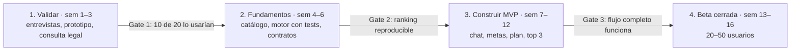

# MVP y roadmap

> Parte del Financial Genius Panamá — Product Master Spec v1 (14 oct 2026). Fuente de verdad: este repo.

## 5. Alcance: MVP 1, V2, V3 y visión

**El MVP 1 resuelve una sola cosa bien: "dime si estoy listo para X, qué hacer este mes y qué producto pedir"**, con 3 tipos de meta y datos ingresados por el usuario.

### MVP 1 — entra

- Onboarding conversacional y selección de varias metas con prioridad.
- **Solo 3 tipos de meta:** tarjeta de crédito, préstamo de auto e hipoteca. (Préstamo personal y consolidación en V2.)
- Perfil financiero básico: ingreso, tipo de empleo, antigüedad, deudas y pagos mensuales, APC conocido (autodeclarado), dependientes.
- Carga opcional de un documento (ficha CSS, talonario o carta de trabajo), extracción con confirmación y borrado del original.
- Índice de preparación por meta (0–100) y hasta 4 frenos principales.
- Plan del mes y 3–5 misiones semanales; check-in mensual manual.
- Catálogo inicial de 8–12 bancos y unos 40–60 productos, cargado con ayuda de IA: se pega la URL o el PDF del banco, la IA propone la ficha y una persona la aprueba.
- Top 3 explicado por meta, ficha de producto y comparador simple.
- Chat contextual sobre cualquier meta, freno o producto.
- Cuenta, login y sincronización entre Web y móvil.
- Paywall preparado pero apagado al inicio (todo gratis durante la validación).

### MVP 1 — no entra

- Aplicar a productos desde la app, referidos pagados y publicidad.
- Conexión con bancos o con la APC.
- Radar, alertas automáticas y rutas alternativas.
- Guardar documentos (bóveda).
- Apps nativas separadas (Swift / Kotlin).

### Fases

| Fase | Objetivo | Incluye | Condición para pasar a la siguiente |
| --- | --- | --- | --- |
| MVP 1 | Validar que la gente quiere la ruta y confía en el top 3 | Lo de arriba | 50+ usuarios activos, 40% vuelve al check-in del mes 2 |
| V2 | Retención y primeros ingresos | Premium activo, Radar básico (sobre datos del usuario y cambios del catálogo), rutas alternativas, préstamo personal y consolidación, notificaciones push | 5% de conversión a Premium o un acuerdo de referidos firmado |
| V3 | Distribución y monetización con bancos | Referidos y solicitud asistida, patrocinios etiquetados, bóveda de documentos con consentimiento, historial de decisiones | Marco legal resuelto para intermediación |
| Visión (3–5 años) | Financial OS | Gemelo financiero, integraciones autorizadas, optimización continua de todos los productos del usuario | — |

Las condiciones de paso son hipótesis iniciales; se ajustan con los primeros datos reales.

## 12. Plan de validación, roadmap y métricas

**Primero se valida con personas reales, después se construye.** Con dedicación parcial (noches y fines de semana), el MVP en beta cerrada es realista en unas 16 semanas.

Cada gate decide si se sigue, se ajusta o se para. Las semanas asumen unas 10–15 horas por semana.

### Validación (fase 1)

- [ ] Entrevistar a 15–20 personas de los segmentos de la sección 3: cómo eligen hoy un banco, qué los frena, si pagarían.
- [ ] Prototipo clicable (Figma o una web simple) con el flujo de la sección 4.
- [ ] Probar 2–3 variantes de UX sobre el mismo flujo: chat primero, metas primero y comparador primero.
- [ ] Hacer a mano, para 5 personas, el diagnóstico y top 3 "como si fuera la app" (concierge MVP).
- [ ] Consulta legal con las preguntas de la sección 10.
- [ ] Elegir nombre definitivo y verificar dominio y marcas.

### Métricas del MVP

| Métrica | Definición | Meta inicial |
| --- | --- | --- |
| Activación | % que llega a su primer diagnóstico con top 3 o plan | ≥ 60% |
| Tiempo a valor | Minutos desde registro hasta el primer diagnóstico | ≤ 5 min |
| Comprensión | % que responde "entiendo por qué" sobre su top 3 | ≥ 80% |
| Retención | % que hace el check-in del mes 2 | ≥ 40% |
| Misiones | % de misiones semanales completadas | ≥ 50% |
| Intención de pago | % que dice que pagaría USD 3–5/mes | ≥ 15% |
| Costo LLM | USD por usuario activo al mes | Medir; mantener bajo el precio Premium |

Las metas son hipótesis para la primera beta; se recalibran con los datos reales.
