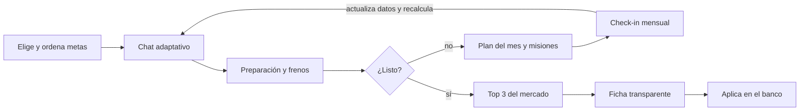

# Producto

> Parte del Financial Genius Panamá — Product Master Spec v1 (14 oct 2026). Fuente de verdad: este repo.

## 1. Resumen ejecutivo

**Financial Genius Panamá es un genio financiero conversacional que convierte tus metas en rutas, te acompaña con misiones semanales y, cuando estás listo, busca en todo el mercado panameño las 3 mejores opciones para ti.**

Este documento es la fuente de verdad del producto. Fusiona los 7 conceptos de UX explorados (Hitmonk, Duolingo, Airbnb, Genius Chat, Financial GPS, Opportunity Radar y Financial OS) en un solo producto con un solo backend.

**Propuesta de valor en una frase:** Tú me dices a dónde quieres llegar; yo te digo cómo llegar y qué producto pedir cuando estés listo.

**Decisiones clave de esta versión:**

- Un solo producto y un solo backend. Los 7 conceptos son experimentos de UX, no productos separados.
- MVP 1 = Chat + Metas/Ruta + Misiones + Top 3 del mercado. Radar entra en V2; Financial OS es la visión a 5 años.
- Un solo código cliente para Web, iOS y Android (Expo/React Native + web). Nada nativo puro en el MVP.
- El LLM conversa y explica; las tasas, requisitos y el ranking salen de datos y reglas deterministas, nunca del modelo.
- Antes de escribir mucho código: validar demanda con 10–20 personas y revisar el marco legal en Panamá.

**Riesgos principales:** mantener el catálogo bancario actualizado, el marco regulatorio de recomendar productos financieros y lograr confianza del usuario para compartir datos sensibles.

## 2. Qué tomamos de cada concepto

Cuatro conceptos forman el núcleo del MVP; Airbnb aporta la filosofía de diseño; Radar y Financial OS quedan para después.

| Concepto | Rol en el producto | Qué tomamos | Qué dejamos fuera | Fase |
| --- | --- | --- | --- | --- |
| 04 Genius Chat | Cerebro y personalidad | Chat como entrada principal, preguntas una a una, tarjetas interactivas dentro del chat, contexto persistente | Esconder todo detrás del chat: metas, plan y productos siempre visibles como pantallas | MVP 1 |
| 05 Financial GPS | Concepto central | Meta = destino; situación actual → obstáculos → hitos → "listo para comparar"; recalcular ruta cuando cambian datos | Rutas alternativas (rápida, barata, menor riesgo) | MVP 1 (alternativas en V2) |
| 02 Duolingo | Progresión y hábito | % de preparación por meta, plan del mes como "capítulo", acciones semanales como misiones, check-in mensual | Rachas, ligas, premiar pedir crédito o endeudarse | MVP 1 |
| 01 Hitmonk | Momento de decisión | Top 3 explicado, "por qué encaja contigo", comparador expandible, "¿por qué quedó #2?" | Comparador abierto tipo buscador como pantalla principal | MVP 1 |
| 03 Airbnb | Diseño y confianza | Fichas de producto limpias, "por qué te la mostramos", "qué confirmar con el banco", patrocinios separados y etiquetados | Home editorial tipo marketplace | MVP 1 (como guía de diseño) |
| 06 Opportunity Radar | Proactividad | Señales de oportunidad y riesgo con impacto y evidencia | Todo en MVP: requiere historial y datos frescos | V2 |
| 07 Financial OS | Visión | "Gemelo financiero", historial de decisiones, módulo de deudas y productos actuales | Todo como MVP | V3 / 5 años |

**El producto en una línea por concepto:** el chat entiende (Genius), la ruta orienta (GPS), las misiones mueven (Duolingo), el top 3 decide (Hitmonk), todo se ve confiable (Airbnb), luego el sistema avisa (Radar) y al final lo organiza todo (OS).

## 3. Usuarios, problema y principios

**El problema:** en Panamá, una persona que quiere una casa, un auto o una tarjeta no sabe si está lista, qué la frena ni qué banco le conviene. Compara a mano, banco por banco, y aplica a ciegas. Un rechazo cuesta tiempo y puede afectar su historial.

### Usuarios objetivo del MVP

| Segmento | Situación | Meta típica | Qué necesita del Genio |
| --- | --- | --- | --- |
| Asalariado joven (25–40) | Empleo formal, poco o ningún historial de crédito | Primera tarjeta, primer auto | Saber si califica y cuál pedir primero |
| Familia que quiere comprar casa | Ingreso estable, algunas deudas | Hipoteca | Ruta de 6–18 meses para estar listo |
| Endeudado que quiere ordenarse | Varias tarjetas o préstamos | Consolidar deuda, bajar utilización | Plan mes a mes y mejor producto de consolidación |
| Independiente / informal | Ingresos variables o sin planilla | Tarjeta asegurada, préstamo pequeño | Opciones reales para su perfil |

**Usuario piloto:** asalariado formal con 1–3 metas (tarjeta + auto o casa). Es el segmento con más productos disponibles y datos más fáciles de reunir.

### Principios no negociables

1. **Varias metas, con prioridad.** El usuario elige una o varias metas y las ordena.
2. **Recomienda, explica y acompaña; nunca promete aprobación.** No inventa políticas internas de los bancos.
3. **APC reportado y preparación propia, siempre separados.** El índice de preparación es nuestro y se dice así.
4. **Diagnóstico adaptativo.** Pregunta solo lo necesario para la meta elegida.
5. **Documentos efímeros en el MVP.** Se extraen datos, el usuario confirma y el original se borra.
6. **El dinero nunca altera el ranking.** Patrocinios separados y etiquetados.
7. **Cada recomendación muestra sus razones, sus supuestos, la fuente y la fecha del dato.**
8. **El LLM no es fuente de verdad** para tasas, costos ni requisitos.
9. **Gratis útil de verdad.** Premium añade acompañamiento continuo, no desbloquea lo básico.
10. **Nada de gamificar la deuda.** Se celebra preparar y ordenar, no pedir crédito.

## 4. Experiencia de producto

**El chat es la puerta de entrada; Metas, Plan y Productos son la memoria visible de lo que el Genio sabe y está siguiendo.** Nada importante vive solo dentro del chat.

### Flujo principal

El usuario entra por el chat, recibe su preparación por meta y, según esté listo o no, pasa al top 3 o a las misiones del mes. Cada check-in recalcula la ruta. En el MVP la solicitud se hace directamente con el banco, fuera de la app.

### Navegación (5 tabs, igual en Web, iOS y Android)

| Tab | Concepto de origen | Qué muestra |
| --- | --- | --- |
| Genio (inicio) | Genius Chat | Conversación persistente, tarjetas interactivas, sugerencias rápidas ("quiero una tarjeta con cashback") |
| Metas | GPS + Duolingo | Cada meta como destino: % de preparación, frenos, próximo hito, prioridad 1/2/3 |
| Plan | Duolingo | Plan del mes y misiones de la semana, con checkbox y progreso |
| Productos | Hitmonk + Airbnb | Top 3 por meta, fichas, comparador, guardados |
| Perfil | Financial OS (básico) | Datos financieros, de dónde sale cada dato, consentimientos, plan Free/Premium |

### Ejemplo de tarjeta de meta

> 🏠 **Comprar mi casa** — Preparación: 47%  
> Meta del mes: bajar utilización de tarjetas a menos de 30%  
> Esta semana: ✓ Pagar tarjeta A · ○ Actualizar deuda B · ○ Pedir carta de trabajo

### Ejemplo de momento Hitmonk

> Revisé 18 tarjetas disponibles en Panamá. Estas 3 encajan mejor contigo: #1 Banco X, #2 Banco Y, #3 Banco Z. ¿Te explico por qué las ordené así?

### Reglas de UX

- Una pregunta a la vez en el chat; botones de respuesta rápida siempre que se pueda.
- Primera recomendación útil en menos de 5 minutos.
- Toda cifra muestra fuente y fecha; todo ranking tiene "¿por qué?".
- Notificaciones abren una conversación concreta: "Actualicemos tu plan de noviembre".
- Celebraciones sobrias al completar misiones; nunca por solicitar crédito.

## 11. Freemium y monetización

**Gratis resuelve el problema real (saber si estás listo y qué pedir); Premium vende acompañamiento continuo.** El paywall se construye en el MVP pero se activa en V2, después de validar.

| Función | Gratis | Premium (hipótesis USD 3–5/mes) |
| --- | --- | --- |
| Metas activas | 1 | Ilimitadas, con prioridades |
| Diagnóstico y frenos | Sí | Sí, con desglose completo |
| Top 3 del mercado | Sí | Sí + comparador completo y guardados |
| Plan del mes y misiones | Solo el primer mes | Todos los meses, con check-ins y recordatorios |
| Chat con el Genio | Límite mensual de mensajes | Sin límite práctico |
| Lectura de documentos | 1 al mes | Varios al mes |
| Historial y evolución | — | Sí |
| Radar y alertas (V2) | — | Sí |

### Otras fuentes de ingreso (V2–V3)

- **Referidos:** comisión del banco cuando el usuario solicita un producto desde la app. Requiere acuerdo comercial y revisión legal.
- **Patrocinios:** espacios etiquetados como "Patrocinado", separados físicamente del top 3.
- **B2B (exploratorio):** licenciar el motor de preparación a cooperativas, empleadores (bienestar financiero) o a los propios bancos.

**Costo a vigilar:** cada conversación consume tokens del LLM. Hay que medir el costo por usuario activo desde el primer día y fijar límites al plan gratuito con esos datos.
